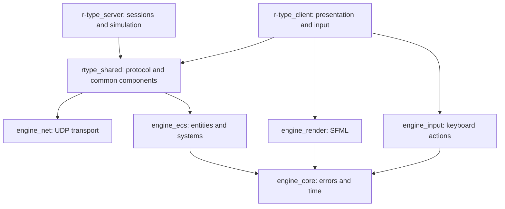

# Architecture overview

The engine supplies reusable building blocks. The game defines R-Type's packet schema,
sessions, authoritative rules and visual presentation. Engine code never includes game headers.

## Current frame flow

1. The client processes window events and samples actions. Unfocused windows send released buttons.
2. `NetworkClient` polls received datagrams, retries joining, and sends action bits/heartbeats.
3. The server validates packets, checks endpoint/token, and retains each player's latest input.
4. At 60 ticks/s, the server advances positions and clamps ships to the logical world.
5. Every third tick it sends a full snapshot to every confirmed client (20 snapshots/s).
6. The client creates/updates/removes network ships, advances local stars, and renders at up to 60 FPS.

Only the server moves network ships. The client does not currently predict movement or interpolate
snapshots; positions may visibly step under latency. The starfield is presentation and never travels over UDP.

## Ownership

| Data | Owner | Consumers |
|---|---|---|
| UDP socket and receive/send queues | `UdpTransport` I/O thread | Game main thread via `poll()`/`send()` |
| Sessions, input state and server ECS | Server main thread | Snapshot encoder |
| Client ECS, window and textures | Client main thread | Rendering systems |
| Wire format | `rtype::protocol` | Server and client |

See the [network documentation](../RESEAU.md) for threading, protocol and error handling,
and the [module inventory](engine-modules.md) for engine responsibilities.
