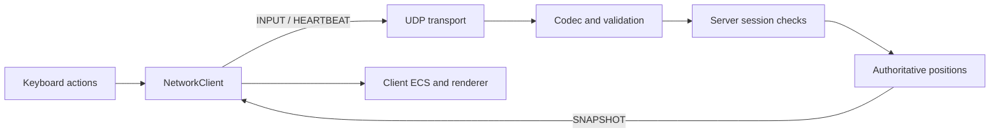

# Network documentation (RESEAU)

This guide describes the current implementation, its public APIs, operating instructions,
error handling and known gaps. It is the single version-1 wire reference, including field
definitions and golden byte examples. The [roadmap](roadmap.md) lists future work.

## 1. Scope and implementation status

The game currently synchronizes player movement between one authoritative server and up to
four clients. The server owns ship positions; clients send button states and render snapshots.
There is one room. Communication uses IPv4 UDP, with numeric IPv4 addresses only.

| Feature | Current behavior |
|---|---|
| Binary codec | Encodes/decodes all RFC message types, with bounded structural validation |
| Connection | CONNECT/ACCEPT/REJECT, retried requests, pending slots and token confirmation |
| Sessions | Four slots, endpoint/token checks, explicit departure and five-second expiration |
| Simulation | Server movement at 60 ticks/s; snapshots every third tick |
| Client presentation | Replicated ship creation/update/removal and local stars |
| Input | Arrow keys; held Fire creates a kind-2 missile every 0.2 s, removed once it leaves the world |
| Enemies | Kind-3 Bydos spawn beyond the right edge every 0.6–1.8 s at a random height, flying straight, in a sine wave or in a zigzag; removed once past the left edge |
| Combat | A player missile hitting a Bydo removes the missile and deals 1 damage; a destroyed Bydo gives 100 points to the shooter. A Bydo hitting a ship destroys both: the player loses a life and respawns after 2 s with 2 s of invulnerability while lives remain |
| Game state | Waiting with no player; playing once a player joins; game over when no present player has lives left, then a new round (full lives, zero score, empty world) after 5 s. A player joining during a game over waits for that round |
| Events | Join/departure/shutdown are emitted; ENTITY_DESTROYED (destroyed Bydo or ship) and PLAYER_KILLED are broadcast before the next snapshot. Spent missiles only disappear from snapshots |
| Cosmetic event playback | Not implemented; snapshots update the actual displayed ships |
| Heartbeat | Request/acknowledgement supported; no RTT/ping display yet |
| Recovery | Complete snapshots and periodic inputs; no reliable event channel |
| Advanced smoothing | No interpolation, prediction or reconciliation yet |

A message being documented or decoded does not mean its gameplay effect exists.
Player lives and score in snapshots are authoritative; the client does not display them yet (no HUD).

## 2. Quick start and operating instructions

### Build and run locally

Install dependencies following the repository [README](../README.md), then:

```sh
cmake -S . -B build -DCMAKE_BUILD_TYPE=Release &&
cmake --build build --parallel 2
```

Terminal 1:

```sh
./build/bin/r-type_server -p 4242
```

Terminals 2 and 3, one client per terminal:

```sh
./build/bin/r-type_client -h 127.0.0.1 -p 4242
```

Both windows should show both ships. Focus a window and use the arrow keys. The other window
should display the same movement after receiving the next snapshot. Unfocused clients send
released buttons. Escape/window close quits a client; Ctrl+C requests graceful server shutdown.

### Command-line interface

| Program | Option | Default | Accepted values |
|---|---|---|---|
| Server | `-p` | 4242 | Decimal integer 1..65535 |
| Client | `-h` | 127.0.0.1 | Numeric IPv4 address |
| Client | `-p` | 4242 | Decimal integer 1..65535 |
| Both | `--help` | N/A | Prints usage and exits successfully |

Unknown options, a missing option value or an invalid port terminate with exit code 84.
`-h` means server host, not help. `localhost`, hostnames and IPv6 are not accepted.
In the low-level API only, transport port 0 requests an ephemeral local port; the CLI rejects 0.

The server binds all IPv4 interfaces. Each client uses a different ephemeral UDP source port.
For LAN use, replace 127.0.0.1 with the server's LAN IPv4 address and permit traffic on its UDP
port. On different machines, 127.0.0.1 always addresses that client's own machine.
Internet reachability, NAT traversal, automatic discovery and firewall configuration are not
provided by the application. Windows build/crossplay validation remains pending.

## 3. Architecture and source map



| Responsibility | Source |
|---|---|
| Endpoint/datagram/transport API | `engine/net/include/UdpTransport.hpp` |
| Asio socket and I/O worker | `engine/net/src/UdpTransport.cpp` |
| Wire data model and constants | `game/shared/include/RtypeProtocol.hpp` |
| Big-endian byte writer/reader | `engine/net/include/ByteWriter.hpp`, `engine/net/include/ByteReader.hpp` |
| Message encoding, decoding and validation | `game/shared/src/protocol/Codec.cpp` |
| Sessions, tokens, timeouts and events | `game/server/include/Server.hpp`, `game/server/src/Server.cpp` |
| Game world (ECS registry and 60 Hz scheduler) | `game/server/include/Room.hpp`, `game/server/src/Room.cpp` |
| Ship creation and server systems | `game/server/src/EntityFactory.cpp`, `game/server/src/systems/` |
| Server CLI, clock loop and signals | `game/server/src/main.cpp` |
| Client session/scheduling | `game/client/include/NetworkClient.hpp`, `game/client/src/NetworkClient.cpp` |
| Snapshot-to-ECS mapping | `game/client/src/Client.cpp` |
| Shared CLI port parsing | `game/shared/src/PortOption.cpp` |

Each process has a main thread and one I/O worker. The main thread owns the game/session/ECS
state. The worker owns socket operations and transfers received bytes through a mutex-protected
queue. Asio is hidden from game headers. Outgoing buffers remain alive until send completion.

The server loop uses the engine `Clock` and `FixedTimestep`: it polls the network continuously,
runs as many 1/60-second ticks as the elapsed time requires, and bounds catch-up after a long
suspension (250 ms). Movement advances by velocity times the tick duration, while inactivity
uses elapsed steady time. The client's
FixedTimestep advances local stars; networking also uses the steady clock. Registries and
schedulers are not thread-safe and must remain on their owning main thread.

## 4. Protocol reference

This is the version-1 wire contract. Every packet is exactly one UDP datagram. Maximum
accepted length is 1200 bytes; the application provides no packet splitting/reassembly.
The words MUST, MUST NOT and SHOULD express requirements for compatible implementations.

### 4.1 Data encoding

#### Primitive types

| Type | Size | Description |
|---|---|---|
| `u8` | 1 byte | unsigned integer |
| `u16` | 2 bytes | unsigned integer |
| `u32` | 4 bytes | unsigned integer |
| `i16` | 2 bytes | signed integer, two's complement |

- All multi-byte integers are sent in **big-endian** order ("network byte order"): the most significant byte first.
  For example, the `u16` value `0x1234` is sent as the bytes `12 34`.
- Fields are written **one after the other**, with **no padding**, in the order given by the tables of the message definitions.
- The protocol uses **no floating-point numbers** and **no strings**.

!!! warning "Never send a C++ struct as-is"
    Copying a struct into a packet (`memcpy`, `reinterpret_cast`) is forbidden: the compiler may add padding
    and the byte order depends on the machine. Each field MUST be written and read one by one.

#### Coordinates

Positions are expressed in a fixed **logical world of 1920 × 1080 units**, whatever the size of the client window.

- Origin `(0, 0)` is the **top-left** corner, `x` grows to the right, `y` grows downwards.
- Coordinates are `i16` (from -32768 to 32767): entities MAY be outside the visible area,
  for example monsters spawning on the right of the screen.
- The client scales the logical world to its window. The server simulates with floating-point
  positions locally and rounds to the nearest integer for transmission. Negative values use
  two's-complement encoding (`-1` is `FF FF`).

### 4.2 Packet format

Every packet starts with a **10-byte header**, followed by a payload whose format depends on the message type.

```
 0                   1                   2                   3
 0 1 2 3 4 5 6 7 8 9 0 1 2 3 4 5 6 7 8 9 0 1 2 3 4 5 6 7 8 9 0 1
+-------------------------------+---------------+---------------+
|          magic (u16)          |  version (u8) |   type (u8)   |
+-------------------------------+---------------+---------------+
|                        sequence (u32)                         |
+-------------------------------+-------------------------------+
|      payload_size (u16)       |   payload (payload_size bytes) ...
+-------------------------------+
```

| Offset | Field | Type | Description |
|---|---|---|---|
| 0 | `magic` | `u16` | Always `0x5254` (the ASCII letters `RT`). Identifies an R-Type packet. |
| 2 | `version` | `u8` | Protocol version. This document describes version `1`. |
| 3 | `type` | `u8` | Message type, see the message type table. |
| 4 | `sequence` | `u32` | Packet number. Each sender keeps its own counter, starting at 0 and increased by 1 for every packet it sends. |
| 8 | `payload_size` | `u16` | Size of the payload in bytes. It MUST be equal to the datagram size minus 10. |

- A packet MUST NOT be larger than **1200 bytes** (header included), to reduce the risk of IP fragmentation; the path MTU may still be smaller.
- The `sequence` field lets the receiver ignore packets that arrive late or out of order (see the message definitions).
  A sequence is newer when `(candidate - previous) mod 2^32` is in `1..2^31-1`.
  Equal values and a distance of exactly `2^31` are not newer. This handles counter wrap.
  A receiver MUST NOT share one input-order counter between different clients. INPUT and
  HEARTBEAT have separate order tracking so a heartbeat cannot suppress a delayed newer input.
  DISCONNECT must be newer than the last accepted INPUT and HEARTBEAT. Snapshot freshness uses
  `tick` with the same modular comparison, independently of cosmetic events.

### 4.3 Message types

The high bit of `type` gives the direction: `0x0_` = client → server, `0x8_` = server → client.

| Code | Name | Direction | Payload size |
|---|---|---|---|
| `0x01` | `CONNECT` | client → server | 0 |
| `0x02` | `INPUT` | client → server | 5 |
| `0x03` | `HEARTBEAT` | client → server | 8 |
| `0x04` | `DISCONNECT` | client → server | 4 |
| `0x81` | `ACCEPT` | server → client | 5 |
| `0x82` | `REJECT` | server → client | 1 |
| `0x83` | `SNAPSHOT` | server → client | 38 + 7 × `entity_count` |
| `0x84` | `HEARTBEAT_ACK` | server → client | 4 |
| `0x85` | `ENTITY_DESTROYED` | server → client | 2 |
| `0x86` | `PLAYER_JOINED` | server → client | 1 |
| `0x87` | `PLAYER_KILLED` | server → client | 1 |
| `0x88` | `PLAYER_LEFT` | server → client | 2 |
| `0x89` | `SERVER_SHUTDOWN` | server → client | 0 |

All other codes are reserved for future versions.

### 4.4 Message payloads

#### Client -> server

##### `CONNECT` (0x01)

Asks the server for a place in the game. No payload.

##### `INPUT` (0x02)

The keys the player is **currently holding** (a state, not a "key pressed" event).

| Field | Type | Description |
|---|---|---|
| `token` | `u32` | Session token received in `ACCEPT`. |
| `buttons` | `u8` | One bit per action, `1` = held. |

| Bit | Mask | Action |
|---|---|---|
| 0 | `0x01` | Up |
| 1 | `0x02` | Down |
| 2 | `0x04` | Left |
| 3 | `0x08` | Right |
| 4 | `0x10` | Fire |
| 5–7 | | Reserved, MUST be 0 |

- The client sends `INPUT` **30 times per second** while it is connected, even if nothing changed:
  a lost packet is replaced by the next one.
- The server uses the newest `INPUT` under the modular sequence comparison and ignores duplicates/older ones.
- If the server receives no `INPUT` from a client for **500 ms**, it considers all its buttons released.

##### `HEARTBEAT` (0x03)

Keeps the session alive and measures the round-trip time (ping).

| Field | Type | Description |
|---|---|---|
| `token` | `u32` | Session token. |
| `timestamp` | `u32` | Client local time in milliseconds (any origin). |

The client sends one `HEARTBEAT` **every second**. The server answers with `HEARTBEAT_ACK` carrying the same
`timestamp`; the client computes the ping as `now - timestamp`.

##### `DISCONNECT` (0x04)

The player quits the game.

| Field | Type | Description |
|---|---|---|
| `token` | `u32` | Session token. |

If this packet is lost, the server detects the departure anyway with the timeout (the session timeout rules).

#### Server -> client

##### `ACCEPT` (0x81)

Answer to `CONNECT` when a place is available.

| Field | Type | Description |
|---|---|---|
| `token` | `u32` | Random non-zero session token. The client MUST put it in all its following packets. |
| `player_id` | `u8` | Player slot, from 0 to 3. It identifies the local ship through `players[player_id]` in snapshots. |

##### `REJECT` (0x82)

Answer to `CONNECT` when the client cannot join.

| Field | Type | Description |
|---|---|---|
| `reason` | `u8` | `1` = server full (4 players), `2` = protocol version mismatch. |

`REJECT` is always sent with the server's own `version` in the header. Its format will never change, so a client
MUST read it even if the version differs from its own.

##### `SNAPSHOT` (0x83)

The complete state of the game at a given server tick.

| Field | Type | Description |
|---|---|---|
| `tick` | `u32` | Server tick number (the server runs at 60 ticks per second). |
| `game_state` | `u8` | `0` = waiting for players, `1` = playing, `2` = game over. |
| `players` | 4 × *Player* | Always 4 entries, the index is the `player_id`. |
| `entity_count` | `u8` | Number of entities that follow, at most **150**. |
| `entities` | `entity_count` × *Entity* | All the entities of the game. |

*Player* (8 bytes):

| Field | Type | Description |
|---|---|---|
| `state` | `u8` | `0` = empty slot, `1` = alive, `2` = dead. |
| `lives` | `u8` | Remaining lives. |
| `score` | `u32` | Score. |
| `entity_id` | `u16` | Id of the player's ship, `0` if it has none. |

*Entity* (7 bytes):

| Field | Type | Description |
|---|---|---|
| `id` | `u16` | Network id of the entity, never `0`. |
| `kind` | `u8` | What the entity is, see the table below. It decides which sprite the client draws. |
| `x` | `i16` | Position, in world units (the coordinate definitions). |
| `y` | `i16` | Position, in world units. |

| `kind` | Entity |
|---|---|
| `1` | Player ship |
| `2` | Player missile |
| `3` | Bydo (basic monster) |
| `4` | Enemy missile |
| `5` | Power-up |
| `6` | Obstacle |
| `7` | Destructible tile |

How the client uses a snapshot:

- It ignores a snapshot whose `tick` is not newer than the last one it applied (the ordering rules).
- An `id` it does not know yet is a **new entity**: it creates it.
- An `id` it knows: it updates the position. If the `kind` changed, it treats it as a new entity.
- An entity it knows that is **absent** from the snapshot no longer exists: it removes it.
- It MUST ignore a `kind` it does not know (draw nothing), without crashing.

A snapshot MUST contain unique nonzero entity IDs. Empty player slots MUST have all other
fields zero. An alive player MUST have at least one life and reference exactly one kind-1 entity
in the snapshot; two players MUST NOT reference the same ship. Dead players have no ship
(`entity_id = 0`); their lives/score may describe respawn/game-over rules. Unknown entity kinds
are deliberately allowed for display compatibility and MUST NOT invalidate a whole snapshot.

The maximum snapshot is `10 + 38 + 7 * 150 = 1098` bytes. It is always complete: the server
MUST limit spawns to at most 150 replicated entities rather than silently truncate the list.
Network IDs have no generation field. Keep removal visible before reusing an ID; version 1
cannot distinguish every immediate reuse of the same ID/kind under packet loss.

The server gives ids from 1 to 65535 in increasing order, goes back to 1 after 65535, and never gives an id
that is still in use.

##### `HEARTBEAT_ACK` (0x84)

| Field | Type | Description |
|---|---|---|
| `timestamp` | `u32` | Copy of the `timestamp` of the `HEARTBEAT` it answers. |

##### `ENTITY_DESTROYED` (0x85)

An entity was destroyed during the game (as opposed to leaving the screen). The client plays an explosion
at the last known position of the entity.

| Field | Type | Description |
|---|---|---|
| `entity_id` | `u16` | Id of the destroyed entity. |

##### `PLAYER_JOINED` (0x86)

| Field | Type | Description |
|---|---|---|
| `player_id` | `u8` | Slot of the new player. |

##### `PLAYER_KILLED` (0x87)

| Field | Type | Description |
|---|---|---|
| `player_id` | `u8` | Slot of the player who was killed. |

##### `PLAYER_LEFT` (0x88)

A player left the game. Sent to the remaining players, so they know when a client has crashed.

| Field | Type | Description |
|---|---|---|
| `player_id` | `u8` | Slot of the player who left. |
| `reason` | `u8` | `1` = the player quit (`DISCONNECT`), `2` = timeout (the client crashed or lost its connection). |

##### `SERVER_SHUTDOWN` (0x89)

The server is stopping. No payload. If this packet is lost, clients detect it with the timeout (the session timeout rules).

Events are best effort. Losing an event must not change authoritative gameplay; complete
snapshots and timeouts determine the actual state. Event playback is future work.

### 4.5 Golden byte examples

All values are written in hexadecimal.

**`CONNECT`**, first packet of a client (sequence 0): 10 bytes.

```
52 54  01  01  00 00 00 00  00 00
magic  ver type  sequence   size
```

**`ACCEPT`**: token `0x1A2B3C4D`, player slot 2: 15 bytes.

```
52 54  01  81  00 00 00 00  00 05  |  1A 2B 3C 4D  02
                                   |  token        player_id
```

**`INPUT`**: sequence 42, the player holds Right and Fire (`0x08 | 0x10 = 0x18`): 15 bytes.

```
52 54  01  02  00 00 00 2A  00 05  |  1A 2B 3C 4D  18
                                   |  token        buttons
```

**`SNAPSHOT`**: tick 1200, game playing, player 0 alive with 3 lives, score 1500 and ship id 1, the other slots
empty, two entities: the ship of player 0 at (200, 540) and a Bydo (id 7) at (1800, 300). Payload: 38 + 2 × 7 = 52 bytes.

```
52 54  01  83  00 00 01 2C  00 34      header (sequence 300, payload 52)
00 00 04 B0                            tick = 1200
01                                     game_state = playing
01 03 00 00 05 DC 00 01                player 0: alive, 3 lives, score 1500, ship id 1
00 00 00 00 00 00 00 00                player 1: empty
00 00 00 00 00 00 00 00                player 2: empty
00 00 00 00 00 00 00 00                player 3: empty
02                                     entity_count = 2
00 01  01  00 C8  02 1C                id 1, player ship, x 200, y 540
00 07  03  07 08  01 2C                id 7, Bydo, x 1800, y 300
```


## 5. Session lifecycle and timing

```mermaid
sequenceDiagram
    participant C as Client
    participant S as Server
    C->>S: CONNECT
    S->>C: ACCEPT(token, slot)
    Note over S: Pending slot; no ship or snapshots yet
    C->>S: INPUT or HEARTBEAT(token)
    Note over S: Confirm endpoint and create ship
    S->>C: PLAYER_JOINED and subsequent snapshots
    loop Active session
        C->>S: INPUT, around 30/s
        C->>S: HEARTBEAT, 1/s
        S->>C: HEARTBEAT_ACK
        S->>C: SNAPSHOT, target 20/s
    end
    C->>S: DISCONNECT(token)
    Note over S: Remove ship and free slot
```

CONNECT retries use the same endpoint but fresh sequence numbers. An existing pending/active
endpoint gets the same token/slot; retries do not refresh inactivity. Four slots include pending
connections. Only a valid token-bearing INPUT/HEARTBEAT creates a ship and enables snapshots.

| Timer/limit | Value | Effect |
|---|---|---|
| Server simulation | 60 ticks/s | Advances positions by 1/60 s per tick |
| Snapshot schedule | Every 3 ticks | Sends complete state to confirmed clients |
| INPUT send interval | At least 33333 microseconds | Approximate 30 Hz, checked once per client frame |
| HEARTBEAT interval | At least 1 s | Session activity and echo response |
| Input freshness | 500 ms | Releases all held buttons |
| Session inactivity | 5 s | Removes pending/active session |
| Client server inactivity | 5 s | Prints error and exits client |
| Join retries | t=0,1,2,3,4 s | Failure at the next one-second check if still unanswered |
| CONNECT handling | At most 32 per one-second server window | Further CONNECT requests dropped |
| Same-endpoint ACCEPT retries | At least 200 ms apart | Faster retries dropped |
| Receive queue | 256 datagrams | Additional arrivals dropped |
| Pending sends | 256 datagrams | Additional send requests dropped |

Timers run when the main loop checks them; suspension or a slow frame can delay checks.
The server checks expiration before consuming that tick's inbox. A packet queued close to the
five-second deadline can therefore arrive too late to rescue a session. Heartbeats are separate
from input freshness: a client may remain connected while its ship has stopped.

## 6. Complete error catalogue

The tables list explicit checks and failure paths in the current code. They are not a promise
that every possible OS/hardware failure has a dedicated diagnosis. Silent drops produce no
per-packet error log or metric. Only valid, fresh activity refreshes the relevant timers.

### 6.1 Invalid datagrams and fields

For every rejection below, decoding returns `nullopt` or the transport drops the datagram.
The server/client ignores it and continues receiving. It does not alter gameplay or refresh activity.

| Case | Detection/behavior |
|---|---|
| Datagram shorter than 10 bytes | Reject before parsing header |
| Datagram larger than 1200 bytes | Drop at transport; codec also rejects if called directly |
| Receive error or oversize/truncated receive | Do not queue those bytes; rearm receive unless cancelled |
| Wrong magic | Reject header |
| Unknown message type | Reject during type dispatch |
| Wrong direction | Server rejects server messages; client rejects client messages |
| Unsupported version | Reject, except valid CONNECT and REJECT version-negotiation cases |
| Header payload length differs from received bytes | Reject envelope |
| Truncated fixed-size payload | Bounds check fails before missing field read |
| Extra payload bytes | Reject because reader did not consume the entire datagram |
| Fixed message has wrong payload length | Truncated-read or trailing-byte check rejects |
| INPUT reserved bits set | Reject buttons with any of bits 5..7 set |
| Zero session token | Reject INPUT/HEARTBEAT/DISCONNECT/ACCEPT |
| Player slot outside 0..3 | Reject ACCEPT/PLAYER_JOINED/PLAYER_KILLED/PLAYER_LEFT |
| Invalid REJECT/PLAYER_LEFT reason | Reject reason other than 1 or 2 |
| Invalid game_state or player state | Reject values outside 0..2 |
| Snapshot entity count greater than 150 | Reject before reading entity records |
| Snapshot length not exactly 48 + 7*N including header | Reject count/length combination |
| Zero or duplicate entity ID | Reject entire snapshot |
| ENTITY_DESTROYED with zero ID | Reject event |
| Empty player with nonzero lives, score or ship ID | Reject snapshot |
| Alive player with zero lives or missing ship | Reject snapshot |
| Alive player referencing a non-kind-1 entity | Reject snapshot |
| Two alive players referencing one ship | Reject snapshot |
| Dead player with nonzero ship ID | Reject snapshot |

Unknown entity kinds are an intentional exception: keep a structurally valid snapshot, but
do not draw unsupported entities. No application checksum/MAC exists. A changed bit that
still produces valid fields can pass every check; for example Right changing to Left. Validation
protects parsing and schema consistency, not complete detection of corruption or forgery.

### 6.2 Source, ordering and connection errors

| Case | Current response | Recovery |
|---|---|---|
| Client packet from an unknown endpoint, except CONNECT | Ignore | Endpoint must join first |
| Token belongs to another endpoint or is wrong | Ignore | Use that endpoint's ACCEPT token |
| Server packet from a different address/port | Client ignores | Configure the correct endpoint |
| Structurally valid CONNECT with another version | REJECT reason 2, subject to rate cap | Use a matching protocol version |
| Malformed CONNECT with another version | Ignore | Correct the packet schema first |
| Valid REJECT with a different version | Client decoder accepts it for negotiation | Client reports rejection while joining |
| Four pending/active slots occupied | REJECT reason 1 | Retry manually when a slot is free |
| Duplicate CONNECT | Reuse token/slot, unless rate-limited | Continue with valid token-bearing traffic |
| Too many CONNECT requests | Drop excess requests | Normal client retry may recover; no explicit overload message |
| Pending ACCEPT never confirmed | No ship/snapshots; expire after 5 s | Start a new join attempt |
| Duplicate/old INPUT or HEARTBEAT | Ignore without refreshing freshness/activity | Send a newer sequence |
| DISCONNECT not newer than INPUT/HEARTBEAT | Ignore | A fresh DISCONNECT or inactivity timeout removes the session |
| Duplicate/old snapshot tick | Ignore without refreshing client activity | Wait for a newer snapshot |
| Old non-snapshot server message | Ignore by sequence | Wait for newer traffic |
| ACCEPT/REJECT arrives during an established session | Ignore | Existing session remains unchanged |
| Other server messages arrive before ACCEPT | Ignore while joining | Retry CONNECT and await ACCEPT |
| Sequence/tick wraps | Modular comparison handles normal wrap | No reset needed |
| Sequence distance is exactly 2^31 | Treat as not newer | Not an acceptable normal ordering gap |

The current joining client accepts a valid REJECT from its configured server even before
its first CONNECT has been dispatched; there is no request nonce. Server packets carry no
session token/epoch. A delayed ACCEPT from an earlier attempt or stale traffic after restart
cannot always be distinguished. This is a known protocol limitation, not a guaranteed recovery path.

### 6.3 Lost packets, latency and disconnection

| Lost/delayed message | What happens now |
|---|---|
| CONNECT | Retry at the next one-second interval |
| ACCEPT | A CONNECT retry obtains the same token/slot if reservation is still alive |
| REJECT | Retry CONNECT until reply or five-attempt timeout |
| First confirmation INPUT/HEARTBEAT | Later periodic traffic can confirm the pending session |
| One INPUT | Last held state remains; next fresh INPUT replaces it |
| Release-key INPUT | Previous direction can continue until next INPUT, or 500 ms freshness limit |
| All INPUT for at least 500 ms | Release buttons; valid heartbeats may keep session alive |
| One SNAPSHOT | Display stays at last state; next complete snapshot replaces it |
| Snapshot containing a spawn/removal | Later snapshots include the spawn or omit the removed entity |
| Several snapshots | Visible freeze/stepping possible; no interpolation/prediction |
| HEARTBEAT | Other fresh INPUT/HEARTBEAT can maintain session; next heartbeat follows |
| HEARTBEAT_ACK | Other valid server messages maintain client activity; no ping UI to update |
| Cosmetic event | Effect/notification can be lost permanently; authoritative state comes from snapshots |
| DISCONNECT | Server keeps session until inactivity expires |
| PLAYER_LEFT | Remaining clients remove the ship on a later snapshot |
| SERVER_SHUTDOWN | Client detects absence of valid server packets after 5 s |
| Client crash or total client-to-server outage | Server expires slot/ship after 5 s and continues for others |
| Server crash or total server-to-client outage | Client reports timeout and exits with code 84 |
| Server process restarted | No automatic reconnect; restart/rejoin clients manually |
| Client IP/source port changes | New endpoint fails old session checks; old slot expires |
| Permanent loss of all packets | Join failure or inactivity timeout; no guaranteed recovery |

Periodic state replaces losses; this is not retransmission of the missing packet. A later
snapshot cannot recreate every transient event: an entity spawned and removed entirely between
received snapshots may never have been seen. Future combat effects must tolerate that.

### 6.4 Transport and application failures

| Failure | Detection and current handling |
|---|---|
| Invalid CLI option or missing argument | Entry point prints usage error and returns 84 |
| Invalid/out-of-range port | `parsePort` throws; entry point returns 84 |
| Invalid IPv4 address/hostname passed as `-h` | IPv4 parser throws; client returns 84 |
| Socket creation/bind fails, including port already in use | Constructor throws; entry point prints OS-dependent error and returns 84 |
| UDP receives an error code | Discard that receive, then rearm unless `operation_aborted`; not surfaced as a health exception |
| UDP receives `operation_aborted` | Do not rearm that receive; normal teardown stops I/O |
| UDP send completes with an error code | Error code is ignored; no retry or caller notification |
| Receive inbox full | Drop new arrivals; do not evict already queued data |
| Pending send limit reached | `send()` returns silently without posting the datagram |
| Outgoing raw datagram exceeds 1200 bytes | Throw `NetError` (`datagram exceeds the maximum size`) |
| Invalid outgoing packet values | Encoder throws `GameError` (`invalid outgoing packet`) |
| Writer would exceed maximum packet bytes | `ByteWriter` throws `NetError` |
| Exception escapes an I/O handler | Worker stores it; next `checkHealth`, `poll` or `send` rethrows on main thread |
| Allocation/thread creation failure | May throw; not translated into a malformed-packet drop; entry-point exception handling terminates with 84 |
| Five unanswered join attempts | Throw `GameError` (`connection timed out after five attempts`); client exits 84 |
| Valid full-server rejection | Throw `GameError` (`server full`); client exits 84 |
| Valid version rejection | Throw `GameError` (`protocol version mismatch`); client exits 84 |
| Five seconds without fresh accepted server traffic | Throw `GameError` (`connection lost`); client exits 84 |
| Valid ordered shutdown message | Throw `GameError` (`server stopped`); client exits 84 |
| Server SIGINT/SIGTERM | Best-effort shutdown sends, flushed by the transport destructor (at most 200 ms), normal exit 0 |
| Normal client window close | Best-effort DISCONNECT, flushed by the transport destructor (at most 200 ms), normal exit 0 |

`send()` successfully returning only means it did not throw; it does not prove queuing,
sending or reception. Persistent receive errors are not classified or backed off, and transport
health does not detect an unreachable peer. Session timers provide the eventual liveness signal.
All errors derive from `engine::EngineError` (`NetError` in the engine, `GameError` in the game),
so both entry points report them with the same handler. There is no reconnect/menu recovery in that handler.

## 7. Developer API usage

### Transport

| API | Contract |
|---|---|
| `UdpTransport(port)` | Bind IPv4 and start worker; 0 requests an ephemeral local port |
| `numericEndpoint(address, port)` | Parse/normalize numeric IPv4; invalid address throws |
| `send(peer, bytes)` | Asynchronous best effort, maximum 1200 bytes; may silently drop on saturation |
| `poll()` | Transfer all queued datagrams to caller; returns immediately, possibly empty |
| `checkHealth()` | Rethrow worker exception if stored; does not test peer reachability |
| Destructor | Wait up to 200 ms for pending sends, then stop I/O and join the worker |

Use transport from its owning main thread. Do not race teardown against another caller or
access the game registry from the I/O worker. Data buffers remain alive until send completion.

### Encode and decode

```cpp
#include "RtypeProtocol.hpp"
#include "UdpTransport.hpp"

void dispatchConnect(engine::net::UdpTransport &transport)
{
    const auto server = engine::net::UdpTransport::numericEndpoint("127.0.0.1", 4242);
    rtype::protocol::Packet request;
    request.type = rtype::protocol::MessageType::Connect;
    request.sequence = 0;
    transport.send(server, rtype::protocol::encode(request));
}
```

This sends one request only. A real client must retry, accept its token, confirm and schedule
inputs/heartbeats; use `NetworkClient` for that state machine.

```cpp
for (const auto &datagram : transport.poll()) {
    // Validate the expected peer separately in the client.
    const auto packet = rtype::protocol::decode(datagram.bytes,
        rtype::protocol::Receiver::Server);
    if (!packet)
        continue;
    // Only act after endpoint/token and sequence checks also pass.
}
```

The decoder has no detailed error-result enum: `nullopt` does not distinguish malformed lengths
from invalid fields. Packet fields are an in-memory model; only fields selected by `type` are emitted.
`encode()` is not a session check. Explicitly increment outgoing counters at the application layer.

### Client and server integration

`NetworkClient::update(buttons)` polls inbound traffic and schedules outgoing messages. Call it
regularly from the frame loop. `takeSnapshot()` returns the latest pending snapshot once, or
`nullopt`; intermediate snapshots within a single poll are intentionally superseded.
`disconnect()` sends a best-effort packet and clears the local token; it does not await an ACK.
Continue teardown as in `Client::run`, or allow the server's timeout to handle a lost departure.
The object is not designed for reconnect after `disconnect()`; construct a new client session.

`Server::poll()` expires silent sessions and handles received packets; call it continuously.
`Server::tick(dt)` releases stale inputs, updates the `Room` (one ECS scheduler run) and sends a
snapshot every third tick; call it at the fixed tick rate. `shutdown()` dispatches a best-effort
event; the transport destructor gives it a short dispatch window. The server links no rendering/input module.

## 8. Security and protocol evolution

Endpoint/token checks associate input with a slot, but they are not cryptographic authentication.
Tokens currently use `mt19937` seeded by `random_device`. No application checksum, signature,
encryption, credentials or authenticated server-session identity is present.

Confirmation prevents a blind unconfirmed endpoint from receiving a continuous snapshot stream,
but CONNECT replies still reflect 15 or 11 bytes for a 10-byte request. Rate/queue/session bounds
limit resource growth, not all denial-of-service attacks. An observer able to see or alter traffic
can interfere. A packet with plausible fields may be accepted even when its meaning was modified.

For future work, consider explicit session identity in both directions, stronger token generation,
authentication/integrity appropriate to deployment, counters for dropped/error packets, classified
I/O failures and backoff, plus reliability for messages that must not be lost. These changes are
not implemented. Any incompatible header/payload change requires a version bump, RFC updates,
golden vectors and client/server changes together.

## 9. Troubleshooting

| Symptom | Checks and action |
|---|---|
| Server cannot start | Read error, verify selected port is available, choose another `-p` |
| Five-attempt connection timeout | Check server is running, correct numeric IPv4/UDP port, routing/firewall, slot/rate limits |
| `Server full` | Four slots may include pending clients; close a client or wait for expiration |
| `Protocol version mismatch` | Rebuild client/server from matching wire schema |
| Connected but no movement | Focus correct window, verify periodic INPUT and confirmation; server releases stale input |
| Jerky movement | Check snapshot arrival rate/latency; interpolation is not implemented |
| Client suddenly exits | Read error text: shutdown, inactivity, rejection or propagated exception |
| Client disappears from other windows | Explicit quit or server timeout; absence in full snapshot removes ship |
| Packet injection has no effect | Check type/direction, lengths, fields, endpoint/token and freshness |
| No useful log for a bad datagram | Silent drop is intentional; there are currently no rejection counters |

For a manual acceptance run, verify two windows, movement, clamping, window focus, quitting,
client termination and server shutdown. Keep future loss/delay tests isolated from an active
user network. See the operating instructions above and the [roadmap](roadmap.md).
