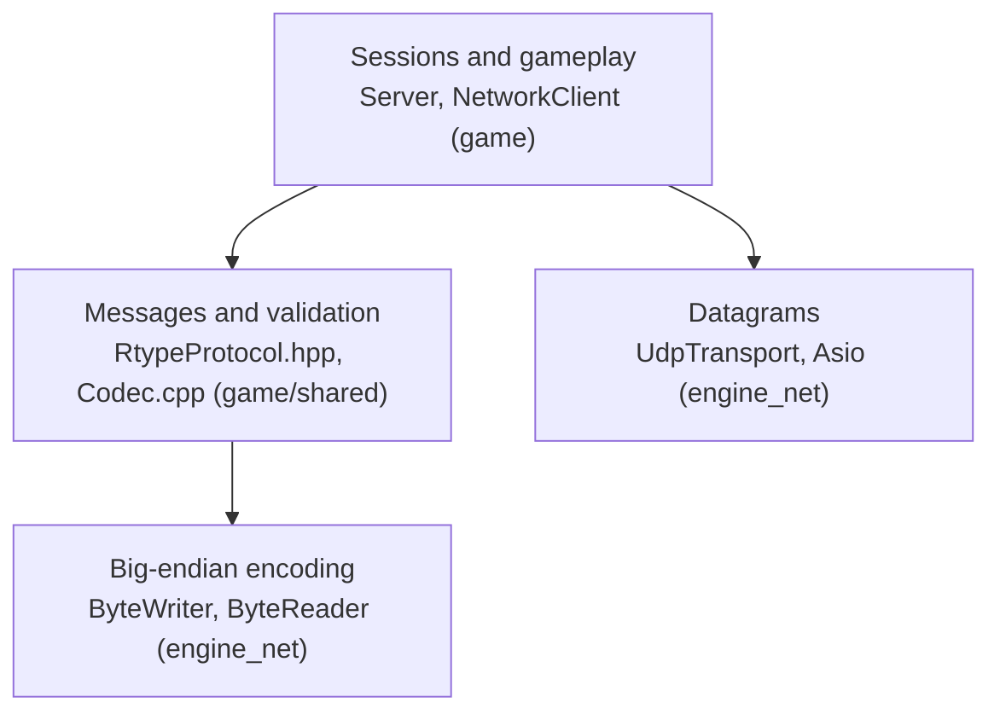

# Networking

This page explains how the network code is organized. The byte-level contract is the
[protocol (RFC)](../protocol.md).

## Three levels

| Level | Knows | Does not know |
|---|---|---|
| `UdpTransport` | Endpoints and byte buffers | Message types |
| `ByteWriter` / `ByteReader` | Integers in network byte order, size limits | What the integers mean |
| `Codec` (`encode` / `decode`) | Every R-Type message and its validation rules | Sessions, timing |
| `Server` / `NetworkClient` | Tokens, sequences, timers, gameplay | Sockets |

## Transport

`UdpTransport` opens one IPv4 UDP socket and runs Asio on a dedicated I/O thread.

- `send(peer, bytes)` queues an asynchronous send and returns immediately.
- `poll()` returns every datagram received since the previous call, without waiting.
- Datagrams larger than 1200 bytes are dropped; at most 256 received datagrams and 256 pending
  sends are kept.
- An exception on the I/O thread is stored and rethrown on the main thread at the next call.

Asio is a private dependency of `engine_net`: it is hidden behind a private implementation
structure, so no game file includes it.

## Messages

Every packet is one datagram: a 10-byte header (magic `0x5254`, version, type, sequence, payload
size) followed by a typed payload. All integers are big-endian and written field by field.
`decode()` returns nothing for any malformed, truncated, oversized or inconsistent packet; the
caller simply ignores it.

## Reliability strategy

| Data | Strategy |
|---|---|
| Player input | Full button state sent ~30 times per second; a lost packet is replaced by the next |
| World state | Complete snapshot 20 times per second; a lost snapshot is replaced by the next |
| Session liveness | Heartbeat every second, 5 s timeout on both sides |
| Ordering | Sequence numbers and snapshot ticks with wrap-around comparison; older data is ignored |
| Events (destroyed, killed, joined, left) | Best effort; the authoritative state is always the snapshot |

## Bandwidth

| Message | Size | Rate |
|---|---|---|
| INPUT (client → server) | 15 bytes | ~30/s per client |
| HEARTBEAT | 18 bytes | 1/s per client |
| SNAPSHOT (server → client) | 48 + 7 × entities bytes, at most 1098 | 20/s per client |

With 150 entities, a client receives at most about 22 KB/s of snapshots, plus UDP/IP headers.
