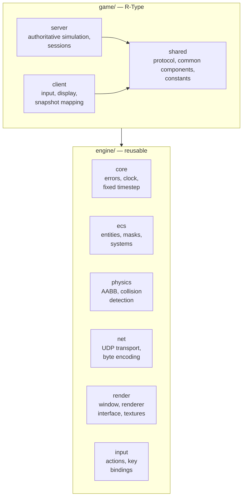
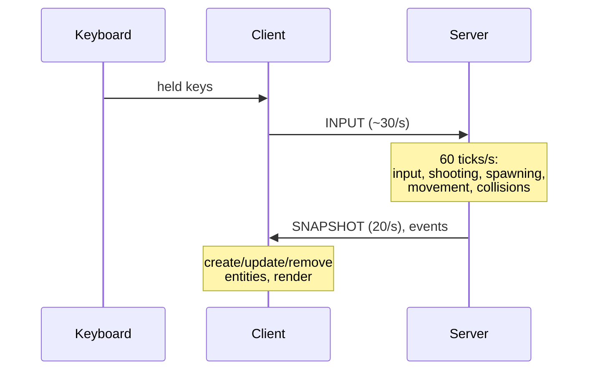

# Architecture overview

## Layers

The code is split in two layers. The **engine** provides reusable subsystems and knows nothing
about R-Type. The **game** uses them to implement R-Type's rules, network schema and presentation.
Each engine module is a separate CMake library, so the dependency rules are enforced by the build:
engine code never includes game headers, and the server never links rendering or input.

| Directory | Contents |
|---|---|
| `engine/<module>/include`, `src` | One library per module (`engine_core`, `engine_ecs`…) |
| `game/shared` | Wire protocol and codec, shared components (`Position`, `Velocity`, `Hitbox`), game constants, `GameError` |
| `game/server` | `Server` (sessions), `Room` (game world), server components and systems |
| `game/client` | `Client` (main loop and presentation), `NetworkClient`, client components and systems |
| `assets/` | Sprites copied next to the client at build time |
| `docs/` | This documentation |

## Runtime model

The server owns the truth. Clients send the buttons they hold; the server simulates the world at
60 ticks per second and sends a complete snapshot of it 20 times per second. Clients only render
what they receive, plus purely cosmetic local effects (scrolling stars, ship tilt).

## One server tick

1. `Server::poll()` expires silent sessions and decodes received datagrams.
2. `Server::tick()` releases inputs older than 500 ms, then calls `Room::update()`.
3. `Room` runs its systems in order: Input, Shooting, Spawn, EnemyMovement, Invulnerability,
   Movement, Boundary, Collision, Offscreen. It then handles respawns and the game state.
4. Gameplay events (entity destroyed, player killed) are broadcast.
5. Every third tick, a snapshot of every replicated entity is sent to every connected player.

## One client frame

1. Window events and keyboard state are read.
2. `NetworkClient` receives datagrams and sends INPUT and HEARTBEAT when due.
3. The newest snapshot, if any, is applied to the client's ECS world.
4. Logic systems (stars, ship tilt) run at a fixed 60 Hz.
5. The render system draws stars then sprites.

## Ownership

| Data | Owner | Thread |
|---|---|---|
| UDP socket, receive queue | `UdpTransport` | network I/O thread |
| Sessions, tokens, timers | `Server` | server main thread |
| Server game world (`ServerWorld`) | `Room` | server main thread |
| Client game world (`ClientWorld`), window, textures | `Client` | client main thread |
| Wire format | `rtype::protocol` | — |

Read next: [engine modules](engine-modules.md), [ECS](ecs.md), [server](server.md),
[client](client.md), [networking](networking.md).
