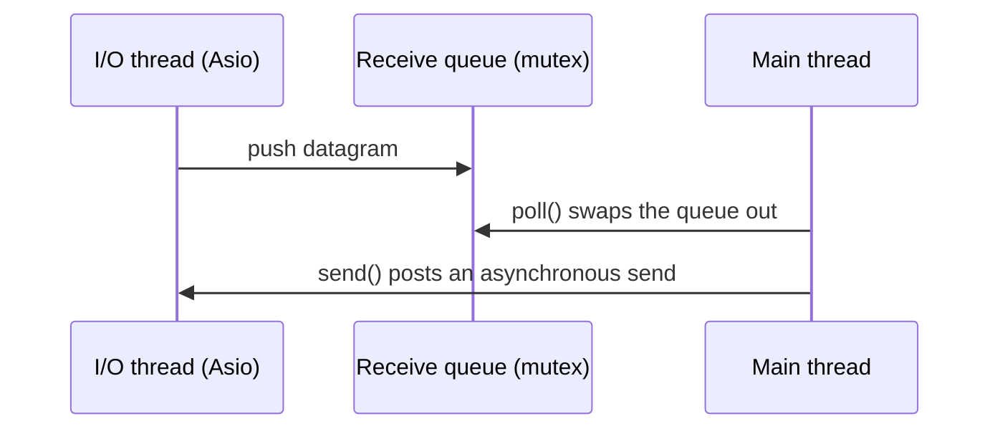

# Threading

Each program runs two threads.

| Thread | Owns | Work |
|---|---|---|
| Main thread | Game world, sessions, systems, window (client) | Fixed-step simulation, packet handling, rendering |
| Network I/O thread | UDP socket, receive buffer | Receives datagrams, completes asynchronous sends |

## Why this design

- The server never waits for a client: receiving happens on the I/O thread, and the main thread
  only collects what has already arrived. The game advances frame after frame regardless of
  client activity.
- Only one small structure is shared: the receive queue, protected by a mutex. `poll()` takes the
  whole queue in one swap, so the lock is held for a very short time.
- The ECS, sessions and rendering are touched by one thread only, so they need no locks and cannot
  have data races.

## Safety rules

- The I/O thread never accesses game data.
- Every I/O handler catches its exceptions; a failure is stored and rethrown on the main thread by
  `poll()`, `send()` or `checkHealth()`.
- Outgoing buffers are owned by the asynchronous operation until it completes.
- The transport destructor waits at most 200 ms for pending sends (for example the final
  `DISCONNECT` or `SERVER_SHUTDOWN`), then stops Asio and joins the thread.
- The server's signal handler only sets a `sig_atomic_t` flag; shutdown runs on the main thread.
