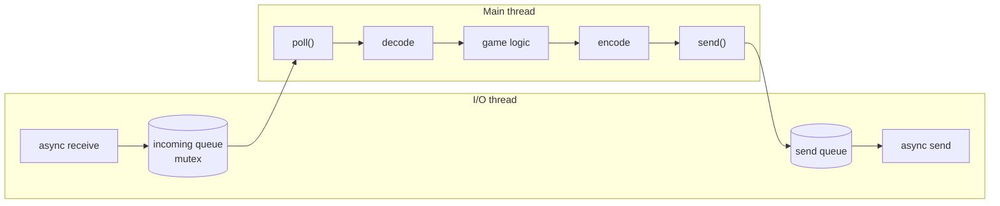

# Threading

The engine uses **two threads per process**, and only one of them touches the game.

| Thread | Created by | Runs |
|---|---|---|
| Main thread | the launcher | Everything: game loop, simulation, Python scripts, rendering, audio, input, packet encoding and decoding |
| Network I/O thread | `UdpTransport` | Asio's event loop: receives datagrams into a queue and performs the queued sends |

## Why this design

- A blocking socket call never freezes the game loop: the main thread only reads a queue.
- The simulation is single-threaded, so it has no locks and is deterministic for a given input sequence.
- Python's interpreter is used from one thread only, which avoids any interaction with its global lock.
- The cost of the simulation is small compared to a frame (a few hundred entities), so parallel systems would
  bring complexity without visible gain.

## Safety rules

- Only `UdpTransport` touches the socket. Its queues are protected by a mutex and bounded to 256 datagrams.
- Datagrams are copied when they cross the thread boundary: no buffer is shared.
- A failure of the I/O thread is stored and raised as a `NetError` on the main thread at the next `poll()`.
- On shutdown, pending sends are flushed for at most 200 ms (so that `DISCONNECT` and `SERVER_SHUTDOWN` leave),
  then the I/O thread is joined.
- Nothing else in the engine creates threads.
