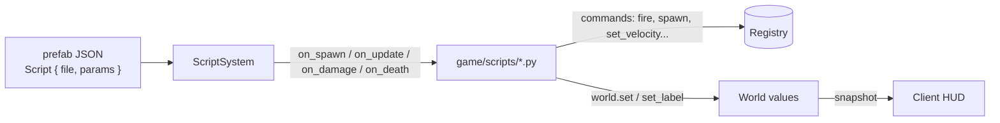

# Scripting reference

Gameplay behaviours (how an enemy moves and shoots, how a boss changes phase, how a level unfolds)
are written in **Python** scripts that the server runs. The engine only provides generic components,
systems and the commands listed below; it knows nothing about the game.

## How it works



1. A prefab declares a `Script` component:

    ```json
    "hopper": {
      "Collider": { ... }, "Health": { "points": 2 },
      "Script": { "file": "hopper.py", "params": { "speed": 300 } }
    }
    ```

2. The `Script` system (listed in `serverSystems`) loads the file from the scripts directory
   (`files.scripts` in the game JSON) the first time an entity uses it, then calls its hooks.
3. Each entity gets one persistent handle `e`. Anything a script stores on it (`e.phase = 2`) is kept
   between frames: it is the memory of that entity.
4. A Python error never stops the server: the error is printed with its file and line, and the script
   is disabled for that entity only.

Scripts run on the **server only**. The client just receives the result through snapshots.

## Hooks

All hooks are optional; write only the ones you need.

| Hook | Called |
|---|---|
| `on_spawn(e)` | once, on the first frame of the entity |
| `on_update(e, dt)` | every simulation tick, `dt` in seconds |
| `on_damage(e, amount)` | when the entity lost health since the previous tick |
| `on_death(e)` | when the entity is killed (it can still fire or spawn in this hook) |
| `on_contact(e, other)` | when the entity overlaps another one its collider can hit (pick-ups, triggers) |

## Entity commands (`e`)

| Command | Description |
|---|---|
| `alive()` / `exists()` | still playing / still in memory (true during `on_death`) |
| `age()` | seconds since the entity appeared |
| `every(name, seconds)` | true once every `seconds`, one timer per name |
| `x()`, `y()`, `width()`, `height()`, `center_x()`, `center_y()` | position and collider size |
| `vx()`, `vy()`, `set_velocity(vx, vy)`, `set_position(x, y)` | movement |
| `health()`, `max_health()` | health points |
| `number(name, fallback)`, `text(name, fallback)` | `params` of the prefab |
| `fire(prefab, angle, speed, dx=0, dy=0)` | spawns a projectile from the centre; angle in degrees, 0 = right, 90 = down, 180 = left |
| `fire_spread(prefab, count, spread, angle, speed)` | `count` projectiles spread over `spread` degrees around `angle` |
| `fire_at_player(prefab, speed)` | aimed at the closest player |
| `nearest_player()` | `(x, y)` centre of the closest player, or `None` |
| `angle_to_player()` | angle toward the closest player |
| `spawn(prefab, dx=0, dy=0)` | spawns an entity relative to this one, returns its handle |
| `set_invulnerable(seconds)` | ignores damage for a while |
| `destroy()` | removes the entity silently |
| `kill()` | kills the entity (explosion, score, `on_death` of others) |
| `is_player()`, `player_slot()` | is this a player ship, and which player (0-3, -1 otherwise) |
| `heal(amount)`, `set_health(points, maximum)` | change health |
| `set_weapon(prefab, cooldown, count=1, spread=0)` | change a ship's weapon (several shots spread over `spread` degrees) |
| `input_held("fire")`, `input_released("fire")`, `input_pressed("action")` | read the player's buttons (charged shot, special action) |
| `attach_to(other, dx, dy)`, `detach()`, `attached()`, `parent()` | stick to another entity (the engine moves it every tick) |
| `set_angle(degrees)` | rotate the sprite on every client |
| `set_player_value(name, value)` | per-player HUD value declared in `playerValues` |
| `world` | the world commands below |

## World commands (`e.world`)

| Command | Description |
|---|---|
| `time()`, `every(name, seconds)`, `random(min, max)` | clock, timers, random numbers |
| `spawn(prefab, x, y)` | spawns an entity at an absolute position, returns its handle |
| `can_spawn()` | false when the match is not running or the entity limit is reached |
| `count_scripted(file)` | number of living entities using that script |
| `players_alive()` | number of player ships in play |
| `match_phase()` | `"waiting"`, `"playing"` or `"over"` |
| `end_match()` | ends the match (used for a victory) |
| `width()`, `height()` | size of the world |
| `set(name, value)`, `get(name)` | integer world values sent to every client |
| `set_label(name, label)`, `label(name)` | same, using the labels declared in the game JSON |
| `log(text)` | prints a line on the server console |
| `players()` | handles of every player ship in play |
| `rule(name)` | room rule chosen in the lobby (labels declared in `rules`) |
| `play_sound(name)` | plays a sound declared in `eventSounds` on every client |

## World values

World values are the only game state a script publishes to the clients. They are declared in the game
JSON, so the engine never needs to know what they mean:

```json
"worldValues": [
  { "name": "stage" },
  { "name": "phase", "labels": ["intro", "running", "boss", "clear", "victory", "defeat"] },
  { "name": "progress" },
  { "name": "bossHealth" }
]
```

The client stores each one as `world.<name>` (the label when there is one), so HUD elements can use
them directly: `"BoundText": { "format": "STAGE {world.stage}" }`,
`"ProgressBar": { "key": "world.progress", "max": 100 }`,
`"VisibleWhen": { "key": "world.phase", "value": "boss" }`.

## Other declarations in the game JSON

- `playerValues`: per-player values shown by the HUD as `player<slot>.<name>` (weapon, force, charge).
- `rules`: room rules offered by `Choice` widgets in the lobby (`field.rule.<name>`), read with `world.rule`.
- `eventSounds`: sounds a script may trigger on the clients with `world.play_sound`.

Generic components scripts and prefabs can rely on: `Attachment`, `Solid` / `Pushable` (walls that push players),
`Tilemap` (scrolling grid of tile prefabs), `Rotation`, `HitFlash`, `ParticleEmitter` / `Lifetime`,
`MusicWhen` (music by HUD value) and the `Shake` system (screen shake driven by a value).

## Python runtime

The server embeds Python through pybind11. The build copies the Python standard library next to the
server (`build/bin/python/`), so no system Python is needed at runtime.
