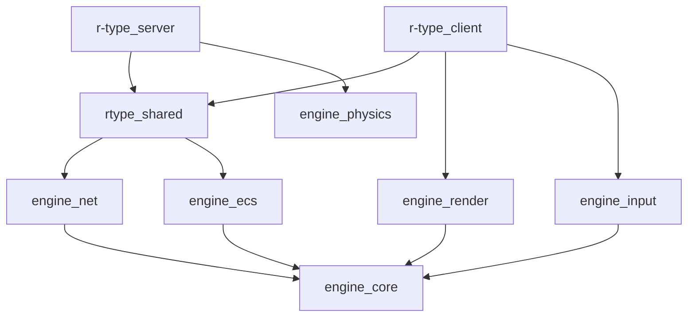

# R-Type documentation

R-Type is a networked multiplayer horizontal shoot'em up written in C++20 on top of a custom,
reusable game engine. Up to four players connect to an authoritative server, move their ships,
shoot missiles and fight Bydos that spawn at random on the right of the screen.

## Where to start

| You want to… | Read |
|---|---|
| Build and run the game | [Installation](getting-started/installation.md), [Building](getting-started/building.md), [Running](getting-started/running.md) |
| Understand the project quickly | [Onboarding](contributing/onboarding.md), then the [architecture overview](architecture/overview.md) |
| Understand the engine | [Engine modules](architecture/engine-modules.md), [ECS](architecture/ecs.md) |
| Understand the game | [Server](architecture/server.md), [Client](architecture/client.md) |
| Write a new client | [Protocol (RFC)](protocol.md) |
| Add content | [Add a component](guides/add-a-component.md), [Add a system](guides/add-a-system.md), [Add an enemy](guides/add-an-enemy.md) |
| Know why things are built this way | [Design decisions](architecture/decisions.md), [Comparative study](comparative-study/index.md) |
| Contribute | [Coding conventions](contributing/conventions.md) |

## Project at a glance



The engine (`engine/`) knows nothing about R-Type. The game (`game/`) is split into the server,
the client and the code they share.

## Browse this documentation as a website

The pages are written in Markdown and rendered with MkDocs Material (navigation, search bar,
outline). From the repository root:

```sh
python3 -m venv .venv
. .venv/bin/activate
python -m pip install mkdocs-material pymdown-extensions
mkdocs serve
```

Then open <http://127.0.0.1:8000>. `mkdocs gh-deploy` publishes the same site on GitHub Pages.
