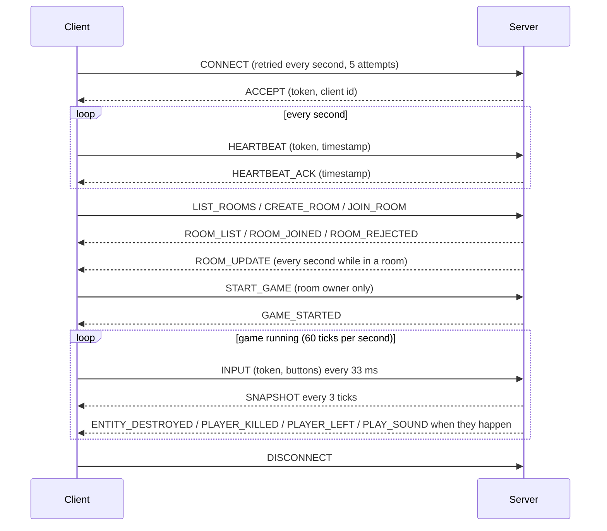

# Network protocol (RFC)

```
Status:   Implemented
Version:  7
Transport: UDP, one message per datagram
Source of truth: engine/network/
```

This document specifies the binary protocol spoken between the game server (`r-type_server`) and its clients
(`r-type_client`). It is written so that a developer can implement a **new compatible client or server from this
document alone**, without reading the C++ sources.

The key words **MUST**, **MUST NOT**, **SHOULD** and **MAY** are to be interpreted as described in RFC 2119.

---

## 1. Overview

- The server is **authoritative**: it runs the whole simulation. Clients only send button states and lobby
  requests, and draw what the server describes.
- Every message is **one UDP datagram** of at most **1200 bytes** (header included), small enough to avoid IP
  fragmentation on usual networks.
- All multi-byte integers are **big-endian** (network byte order).
- There is no retransmission: game state is resent continuously (snapshots), so a lost datagram is simply
  replaced by the next one.
- A session is identified by a random 32-bit **token** given by the server. Every client message after
  `CONNECT` carries it.



---

## 2. Data types

| Type | Size | Encoding |
|---|---|---|
| `u8` | 1 | unsigned integer |
| `u16` | 2 | unsigned integer, big-endian |
| `i16` | 2 | two's complement signed integer, big-endian |
| `u32` | 4 | unsigned integer, big-endian |
| `string` | 1 + n | `u8` length `n` (0 to 255), then `n` bytes. No terminator. |
| `bool` | 1 | `0` = false, `1` = true |
| `list<T>` | 1 + ... | `u8` element count, then the elements one after the other |

**Text rules.** Every `string` field MUST only contain printable ASCII characters (`0x20` to `0x7E`).
Each field has its own length limits, given in the message tables below.

**Coordinates.** Entity positions are `i16` values in **world units** (pixels of a 1920 x 1080 world for R-Type).
The origin is the top-left corner, `x` grows to the right and `y` grows downward.

---

## 3. Packet format

Every datagram starts with a fixed **10-byte header**, followed by the payload of the message.

```
 0                   1                   2                   3
 0 1 2 3 4 5 6 7 8 9 0 1 2 3 4 5 6 7 8 9 0 1 2 3 4 5 6 7 8 9 0 1
+-------------------------------+---------------+---------------+
|          magic (u16)          | version (u8)  |   type (u8)   |
+-------------------------------+---------------+---------------+
|                        sequence (u32)                         |
+-------------------------------+-------------------------------+
|      payload size (u16)       |      payload ...              |
+-------------------------------+-------------------------------+
```

| Offset | Field | Type | Description |
|---|---|---|---|
| 0 | `magic` | `u16` | Always `0x454E` (ASCII `EN`, for "engine"). |
| 2 | `version` | `u8` | Protocol version. This document describes version **7**. |
| 3 | `type` | `u8` | Message type (section 4). Bit `0x80` set means "sent by the server". |
| 4 | `sequence` | `u32` | Sender's counter, incremented for every datagram it sends. Wraps around. |
| 8 | `payload size` | `u16` | Number of bytes after the header. MUST equal `datagram size - 10`. |

### Sequence numbers

Each side keeps its own counter. A receiver compares sequences with wrap-around arithmetic:
`candidate` is newer than `previous` if `(candidate - previous) mod 2^32` is between `1` and `2^31 - 1`.

The server keeps the last accepted sequence **separately** for `INPUT` and for `HEARTBEAT` messages, and drops
any older or duplicated one. Other client messages are not ordered.

---

## 4. Message types

Codes `0x01` to `0x7F` are sent by clients, codes `0x81` to `0xFF` by the server.

| Code | Name | Direction | Purpose |
|---|---|---|---|
| `0x01` | `CONNECT` | C -> S | Ask for a session |
| `0x02` | `INPUT` | C -> S | Current state of the buttons |
| `0x03` | `HEARTBEAT` | C -> S | Keep-alive and ping measurement |
| `0x04` | `DISCONNECT` | C -> S | Leave the server |
| `0x05` | `LIST_ROOMS` | C -> S | Ask for the room list |
| `0x06` | `CREATE_ROOM` | C -> S | Create a room and become its owner |
| `0x07` | `JOIN_ROOM` | C -> S | Join an existing room |
| `0x08` | `LEAVE_ROOM` | C -> S | Leave the current room |
| `0x09` | `START_GAME` | C -> S | Start the game of the room (owner) |
| `0x0A` | `KICK_PLAYER` | C -> S | Remove a player from the room (owner) |
| `0x0B` | `DELETE_ROOM` | C -> S | Close the room (owner) |
| `0x0C` | `CONSOLE_COMMAND` | C -> S | Developer console command (owner) |
| `0x81` | `ACCEPT` | S -> C | Session created |
| `0x82` | `REJECT` | S -> C | Session refused |
| `0x83` | `SNAPSHOT` | S -> C | Full state of the game |
| `0x84` | `HEARTBEAT_ACK` | S -> C | Answer to `HEARTBEAT` |
| `0x85` | `ENTITY_DESTROYED` | S -> C | An entity was removed |
| `0x86` | `PLAYER_JOINED` | S -> C | Reserved, not emitted by the current server |
| `0x87` | `PLAYER_KILLED` | S -> C | A player's avatar died |
| `0x88` | `PLAYER_LEFT` | S -> C | A player left a running game (quit or crash) |
| `0x89` | `SERVER_SHUTDOWN` | S -> C | The server is stopping |
| `0x8A` | `ROOM_LIST` | S -> C | List of rooms |
| `0x8B` | `ROOM_JOINED` | S -> C | You are in a room |
| `0x8C` | `ROOM_REJECTED` | S -> C | A room request failed |
| `0x8D` | `ROOM_UPDATE` | S -> C | Seats of the room |
| `0x8E` | `GAME_STARTED` | S -> C | The room's game has started |
| `0x8F` | `KICKED` | S -> C | You were removed from the room |
| `0x90` | `ROOM_CLOSED` | S -> C | The room no longer exists |
| `0x91` | `PLAY_SOUND` | S -> C | Play a game sound |
| `0x92` | `CONSOLE_TEXT` | S -> C | Text for the developer console |

Any other code is invalid and the datagram MUST be dropped.

---

## 5. Message payloads

The tables list the payload fields in order, right after the header.

### 5.1 Client to server

#### `CONNECT` (0x01)

Empty payload. The header `version` tells the server which protocol the client speaks.

#### `INPUT` (0x02)

| Field | Type | Description |
|---|---|---|
| `token` | `u32` | Session token from `ACCEPT` |
| `buttons` | `u8` | Bit field, see below |

| Bit | Mask | Button |
|---|---|---|
| 0 | `0x01` | Up |
| 1 | `0x02` | Down |
| 2 | `0x04` | Left |
| 3 | `0x08` | Right |
| 4 | `0x10` | Fire |
| 5 | `0x20` | Action (game-defined: R-Type uses it for the Force) |
| 6-7 | `0xC0` | Reserved, MUST be 0 |

`INPUT` is a **state**, not an event: the client sends its whole button state every 33 ms while a game runs.
If the server receives no `INPUT` from a player for 500 ms, it releases all of that player's buttons.

#### `HEARTBEAT` (0x03)

| Field | Type | Description |
|---|---|---|
| `token` | `u32` | Session token |
| `timestamp` | `u32` | Any client value, sent back unchanged in `HEARTBEAT_ACK` (the client uses milliseconds to compute its ping) |

#### `DISCONNECT` (0x04)

| Field | Type | Description |
|---|---|---|
| `token` | `u32` | Session token |

#### `LIST_ROOMS` (0x05), `LEAVE_ROOM` (0x08), `START_GAME` (0x09), `DELETE_ROOM` (0x0B)

| Field | Type | Description |
|---|---|---|
| `token` | `u32` | Session token |

#### `CREATE_ROOM` (0x06)

| Field | Type | Description |
|---|---|---|
| `token` | `u32` | Session token |
| `name` | `string` | 1 to `roomNameMaxLength` (16) characters |
| `code` | `string` | 0 to `roomCodeMaxLength` (8) characters. Empty means "public room" |
| `rules` | `list<u8>` | One value per rule declared by the game. R-Type has 3: difficulty, friendly fire, cheats |

The number of `rules` MUST equal the number of rules of the game. Each value is an index into that rule's labels
(for R-Type difficulty: `0` = NORMAL, `1` = HARD, `2` = EASY).

#### `JOIN_ROOM` (0x07)

| Field | Type | Description |
|---|---|---|
| `token` | `u32` | Session token |
| `roomId` | `u16` | Id from `ROOM_LIST` |
| `code` | `string` | 0 to 8 characters, the room code if the room is locked |

#### `KICK_PLAYER` (0x0A)

| Field | Type | Description |
|---|---|---|
| `token` | `u32` | Session token |
| `slot` | `u8` | Seat to free, lower than `maxPlayers` |

#### `CONSOLE_COMMAND` (0x0C)

| Field | Type | Description |
|---|---|---|
| `token` | `u32` | Session token |
| `text` | `string` | 1 to 200 characters, the command line typed in the console |

### 5.2 Server to client

#### `ACCEPT` (0x81)

| Field | Type | Description |
|---|---|---|
| `token` | `u32` | Random non-zero session token |
| `clientId` | `u8` | Index of the client on the server, lower than `maxClients` |

#### `REJECT` (0x82)

| Field | Type | Description |
|---|---|---|
| `reason` | `u8` | `1` = server full, `2` = protocol version mismatch |

`REJECT` is always sent with the **server's** version in the header, and its format will never change.
A client MUST accept it whatever the version is, so that it can report the mismatch.

#### `SNAPSHOT` (0x83)

The complete visible state of the game, sent every `snapshotEveryTicks` ticks (3, so 20 times per second).

| Field | Type | Description |
|---|---|---|
| `tick` | `u32` | Simulation tick number |
| `gameState` | `u8` | `0` = waiting, `1` = playing, `2` = over |
| `worldValues` | `list<u16>` | One value per world value declared by the game (section 6) |
| `players` | `list<PlayerStatus>` | Exactly `maxPlayers` entries, one per seat |
| `entities` | `list<EntityState>` | 0 to `maxEntities` visible entities |

**`PlayerStatus`**

| Field | Type | Description |
|---|---|---|
| `state` | `u8` | `0` = empty seat, `1` = alive, `2` = dead (waiting to respawn or out) |
| `lives` | `u8` | Remaining lives |
| `health` | `u8` | Health of the avatar in percent, 0 to 100 |
| `score` | `u32` | Score |
| `avatarId` | `u16` | Network id of the player's entity in `entities`, `0` if none |
| `values` | `list<u16>` | One value per player value declared by the game (R-Type: weapon, force, charge) |

Rules: an empty seat has every field at 0. A dead player has `avatarId = 0`. An alive player has
`lives > 0` and an `avatarId` that appears in `entities`, and two players never share an avatar.

**`EntityState`** (8 bytes)

| Field | Type | Description |
|---|---|---|
| `id` | `u16` | Network id, never 0, unique in the snapshot |
| `kind` | `u8` | What to draw. The meaning comes from the game's `kinds` table (R-Type: `1` = ship, `2` = missile, ...) |
| `x` | `i16` | Position, world units |
| `y` | `i16` | Position, world units |
| `visual` | `u8` | Bit `0x80`: the entity was just hit (flash it). Bits `0x7F`: rotation, in steps of 360/128 degrees |

The client MUST treat a snapshot as the full truth: entities present in the previous snapshot but absent from
the new one are no longer visible.

#### `HEARTBEAT_ACK` (0x84)

| Field | Type | Description |
|---|---|---|
| `timestamp` | `u32` | The value received in `HEARTBEAT` |

#### `ENTITY_DESTROYED` (0x85)

| Field | Type | Description |
|---|---|---|
| `entityId` | `u16` | Network id of the destroyed entity, never 0 |

Sent when an entity dies, so that the client can play its death effect (explosion) immediately.

#### `PLAYER_KILLED` (0x87)

| Field | Type | Description |
|---|---|---|
| `slot` | `u8` | Seat of the player whose avatar died |

#### `PLAYER_LEFT` (0x88)

| Field | Type | Description |
|---|---|---|
| `slot` | `u8` | Seat of the player who left |
| `reason` | `u8` | `1` = quit (left the room or disconnected), `2` = timeout (crashed or lost the network) |

Sent to the remaining members of a room whose game is running, when a player leaves it. A client that crashes
stops sending heartbeats: after `sessionTimeoutMs` (5 s) the server drops it and sends `PLAYER_LEFT` with reason
`2`. The game goes on for the others. When the owner leaves, the room closes and `ROOM_CLOSED` is sent instead.

#### `PLAYER_JOINED` (0x86)

Reserved, with a `u8 slot`. The current server does not send it: new seats are reported by `ROOM_UPDATE`.

#### `SERVER_SHUTDOWN` (0x89), `GAME_STARTED` (0x8E), `KICKED` (0x8F), `ROOM_CLOSED` (0x90)

Empty payload.

#### `ROOM_LIST` (0x8A)

| Field | Type | Description |
|---|---|---|
| `rooms` | `list<RoomInfo>` | 0 to `maxRooms` (16) rooms |

**`RoomInfo`**

| Field | Type | Description |
|---|---|---|
| `id` | `u16` | Room id, never 0 |
| `name` | `string` | 1 to 16 characters |
| `players` | `u8` | Seated players |
| `capacity` | `u8` | Number of seats |
| `flags` | `u8` | `0x01` = locked by a code, `0x02` = game in progress |

#### `ROOM_JOINED` (0x8B)

| Field | Type | Description |
|---|---|---|
| `roomId` | `u16` | Id of the room |
| `name` | `string` | Name of the room |
| `slot` | `u8` | Your seat in the room |

#### `ROOM_REJECTED` (0x8C)

| Field | Type | Description |
|---|---|---|
| `reason` | `u8` | See the table below |

| Value | Meaning |
|---|---|
| `1` | Room not found |
| `2` | Room full |
| `3` | Wrong code |
| `4` | The server already has the maximum number of rooms |
| `5` | Invalid room name |
| `6` | Too many wrong codes (5): join requests are refused for this session |
| `7` | Not allowed: only the owner can do that |

#### `ROOM_UPDATE` (0x8D)

| Field | Type | Description |
|---|---|---|
| `ownerSlot` | `u8` | Seat of the owner, MUST be an occupied seat |
| `occupied` | `list<bool>` | Exactly `maxPlayers` entries, `1` when the seat is taken |

Sent to every member when the seats change, and every second as a keep-alive of the room.
A client that receives no `ROOM_UPDATE` for 4 seconds while in a room SHOULD consider the room lost.

#### `PLAY_SOUND` (0x91)

| Field | Type | Description |
|---|---|---|
| `sound` | `u8` | Index in the game's `eventSounds` list (R-Type: `0` = warning, `1` = power-up, `2` = boss death) |

#### `CONSOLE_TEXT` (0x92)

| Field | Type | Description |
|---|---|---|
| `text` | `string` | 0 to 200 characters to print in the console |

---

## 6. Game-defined tables

The protocol is generic: some fields only make sense with the game's data file (`<game>_game.json`), which
**both sides MUST share**. A third-party client needs these tables:

| JSON key | Used by | Meaning |
|---|---|---|
| `network.maxPlayers` | `SNAPSHOT`, `ROOM_UPDATE`, `KICK_PLAYER` | Number of seats |
| `network.maxEntities` | `SNAPSHOT` | Maximum number of entities in one snapshot |
| `worldValues` | `SNAPSHOT.worldValues` | Ordered names of the world values. A value with `labels` is an index into them |
| `playerValues` | `PlayerStatus.values` | Ordered names of the per-player values |
| `rules` | `CREATE_ROOM.rules` | Ordered room rules and their labels |
| `eventSounds` | `PLAY_SOUND.sound` | Ordered names of the sounds the server can trigger |
| `kinds` | `EntityState.kind` | Kind number to client prefab name |

R-Type world values, in order: `stage`, `phase` (labels: intro, running, boss, clear, victory, defeat),
`progress`, `bossHealth`, `shake`, `skip`.

The server checks at start-up that `maxPlayers` and `maxEntities` produce a snapshot that fits in 1200 bytes,
and refuses to start otherwise.

---

## 7. Session lifecycle and timing

All values below come from the `network` block of `rtype_game.json`.

| Setting | R-Type value | Effect |
|---|---|---|
| `defaultPort` | 4242 | UDP port of the server |
| `tickRate` (top level) | 60 | Simulation ticks per second |
| `snapshotEveryTicks` | 3 | One `SNAPSHOT` every 3 ticks (20 per second) |
| `inputIntervalMs` | 33 | The client sends `INPUT` every 33 ms in game |
| `inputReleaseDelayMs` | 500 | Buttons are released if no `INPUT` arrives for 500 ms |
| `heartbeatIntervalMs` | 1000 | The client sends `HEARTBEAT` every second |
| `sessionTimeoutMs` | 5000 | The server drops a client silent for 5 seconds |
| `connectRetryIntervalMs` | 1000 | `CONNECT` is resent every second until `ACCEPT` |
| `connectAttempts` | 5 | The client gives up after 5 `CONNECT` |
| `maxClients` | 16 | Connected clients at the same time |
| `maxRooms` | 16 | Rooms at the same time |
| `maxJoinAttempts` | 5 | Wrong codes allowed per session |

### Connection

1. The client sends `CONNECT` with its protocol version.
2. If the version differs, the server answers `REJECT(2)`. If all `maxClients` slots are used, `REJECT(1)`.
3. Otherwise the server creates a session for the client's address and port and answers `ACCEPT(token, id)`.
   A repeated `CONNECT` from the same address within 200 ms is ignored, after that the same session is
   accepted again (lost `ACCEPT`).
4. The session is **confirmed** when the first valid message carrying the token arrives.

### Rooms

- A client is in at most one room. `CREATE_ROOM` or `JOIN_ROOM` while already in a room just answers
  `ROOM_JOINED` again.
- The creator is the **owner** (seat 0). Only the owner may `START_GAME`, `KICK_PLAYER`, `DELETE_ROOM` and use
  `CONSOLE_COMMAND`. Otherwise the server answers `ROOM_REJECTED(7)`.
- If the owner leaves, the room is closed and every member receives `ROOM_CLOSED`.
- A player may join a room whose game is already running: they receive `ROOM_JOINED` then `GAME_STARTED`.

### Console

`CONSOLE_COMMAND` is executed by the game's console script on the server. The server answers with
`CONSOLE_TEXT`. Commands are refused when the sender is not the owner, or when the game's `consoleRule` room
rule (R-Type: `cheats`) is OFF. Commands sent before the game starts are queued and run at start.

### Leaving

A client leaves with `DISCONNECT`, or by staying silent for `sessionTimeoutMs` (crash, network loss). In both
cases the other players of a running game receive `PLAYER_LEFT`. When the server stops, it sends
`SERVER_SHUTDOWN` to every confirmed client.

---

## 8. Validation and error handling

A receiver MUST silently drop a datagram, without answering, when any of these is true:

| Check | Example |
|---|---|
| Size lower than 10 or greater than 1200 bytes | Truncated datagram |
| `magic` is not `0x454E` | Packet of another application |
| Direction bit does not match the receiver | A server message sent to the server |
| `payload size` differs from the real payload length | Corrupted or truncated payload |
| `version` differs, except for `CONNECT` and `REJECT` | Old client |
| Unknown `type` | Code `0x40` |
| The payload is shorter or longer than its message needs | Extra bytes |
| A field breaks its message rules (section 5) | Token 0, reserved buttons set, text with control characters, wrong list size |
| The token does not match the sender's session | Spoofed or stale message |
| A sequenced message (`INPUT`, `HEARTBEAT`) is not newer than the last one | Duplicate or reordered datagram |

**Rate limit.** The server handles at most 32 `CONNECT` per second in total. Extra ones are dropped.

---

## 9. Example datagrams

Byte values are hexadecimal.

**`CONNECT`**, sequence 0:

```
45 4E 07 01  00 00 00 00  00 00
magic ver type  sequence   size=0
```

**`INPUT`** with token `0x12345678`, Up + Fire pressed (`0x11`), sequence 42:

```
45 4E 07 02  00 00 00 2A  00 05  12 34 56 78  11
```

**`ACCEPT`** with token `0x12345678`, client id 3, server sequence 0:

```
45 4E 07 81  00 00 00 00  00 05  12 34 56 78  03
```

**`PLAY_SOUND`** "boss death" (index 2):

```
45 4E 07 91  00 00 00 10  00 01  02
```

---

## 10. Writing a new client

A minimal client that can join a game and display it:

1. Open a UDP socket and send `CONNECT` every second until you get `ACCEPT` (keep the token).
2. Send `HEARTBEAT` every second, or the server drops you after 5 seconds.
3. Send `LIST_ROOMS`, then `JOIN_ROOM` (or `CREATE_ROOM` and `START_GAME`).
4. After `GAME_STARTED`, send `INPUT` every 33 ms with your buttons.
5. On each `SNAPSHOT`, replace your list of entities by the received one and draw each entity according to its
   `kind`, at `(x, y)`.
6. Send `DISCONNECT` when you quit.

Everything else (sounds, console, kicks) is optional.

---

## 11. Security considerations

- The token is random and bound to the sender's address and port: a third party must both guess the token and
  spoof the address to inject messages.
- Every field is checked against strict limits before use, and decoding never reads past the datagram.
- The server never trusts client positions: clients only send buttons.
- The protocol has **no encryption and no authentication of the server**. It is designed for LAN and
  trusted-network play. See [Security](comparative-study/security.md) for the discussion.

---

## 12. Evolution

Any change of a payload or of the header MUST increase `Protocol::VERSION`
(`engine/network/protocol/include/Protocol.hpp`) and update this document. Old clients are then refused with
`REJECT(2)`, which is the only message guaranteed to stay readable.

Only version 7 is supported: any other version is refused with `REJECT(2)`.
