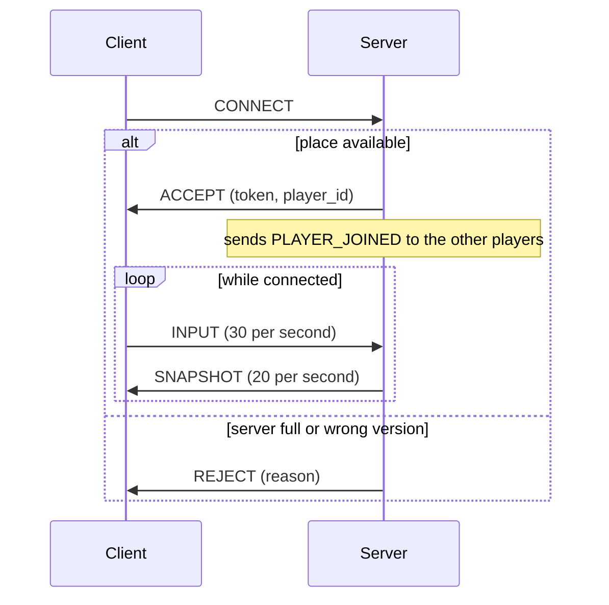

# R-Type Network Protocol — Version 1

| | |
|---|---|
| **Protocol version** | 1 |
| **Transport** | UDP |
| **Default port** | 4242 |
| **Scope** | Part 1: one game room of up to 4 players |

## 1. Introduction

This document specifies the binary protocol used between `r-type_client` and `r-type_server`.
Its goal is that anyone can write a working client for our server by reading this document only.

The key words **MUST**, **MUST NOT**, **SHOULD**, **SHOULD NOT** and **MAY** are to be interpreted as described in
[RFC 2119](https://www.rfc-editor.org/rfc/rfc2119).

## 2. Overview

The server is **authoritative**: it runs the whole game simulation and decides everything that happens
(movements, collisions, deaths, score). Clients only send what the player is doing and display what the
server tells them.

- **Client → server**: the keys the player is holding (`INPUT`), 30 times per second.
- **Server → client**: the full state of the game (`SNAPSHOT`), 20 times per second, plus a few
  **event** messages (an entity exploded, a player joined, died or left).

Every packet is a single UDP datagram. There is no connection at the transport level: the protocol defines
its own session (`CONNECT` / `ACCEPT`, heartbeats and timeouts, see §7).

**Why no acknowledgements or retransmission?** Each `SNAPSHOT` carries the complete state of the game.
If one is lost, the next one (50 ms later) replaces it, so the client never stays wrong for long.
Event messages are only used for effects (explosions, sounds, notifications); everything they describe
can also be deduced from the snapshots. This keeps the protocol simple and tolerant to packet loss.

## 3. Data encoding

### 3.1 Types

| Type | Size | Description |
|---|---|---|
| `u8` | 1 byte | unsigned integer |
| `u16` | 2 bytes | unsigned integer |
| `u32` | 4 bytes | unsigned integer |
| `i16` | 2 bytes | signed integer, two's complement |

- All multi-byte integers are sent in **big-endian** order ("network byte order"): the most significant byte first.
  For example, the `u16` value `0x1234` is sent as the bytes `12 34`.
- Fields are written **one after the other**, with **no padding**, in the order given by the tables of §6.
- The protocol uses **no floating-point numbers** and **no strings**.

!!! warning "Never send a C++ struct as-is"
    Copying a struct into a packet (`memcpy`, `reinterpret_cast`) is forbidden: the compiler may add padding
    and the byte order depends on the machine. Each field MUST be written and read one by one.

### 3.2 Coordinates

Positions are expressed in a fixed **logical world of 1920 × 1080 units**, whatever the size of the client window.

- Origin `(0, 0)` is the **top-left** corner, `x` grows to the right, `y` grows downwards.
- Coordinates are `i16` (from -32768 to 32767): entities MAY be outside the visible area,
  for example monsters spawning on the right of the screen.
- The client scales the logical world to its window.

## 4. Packet format

Every packet starts with a **10-byte header**, followed by a payload whose format depends on the message type.

```
 0                   1                   2                   3
 0 1 2 3 4 5 6 7 8 9 0 1 2 3 4 5 6 7 8 9 0 1 2 3 4 5 6 7 8 9 0 1
+-------------------------------+---------------+---------------+
|          magic (u16)          |  version (u8) |   type (u8)   |
+-------------------------------+---------------+---------------+
|                        sequence (u32)                         |
+-------------------------------+-------------------------------+
|      payload_size (u16)       |   payload (payload_size bytes) ...
+-------------------------------+
```

| Offset | Field | Type | Description |
|---|---|---|---|
| 0 | `magic` | `u16` | Always `0x5254` (the ASCII letters `RT`). Identifies an R-Type packet. |
| 2 | `version` | `u8` | Protocol version. This document describes version `1`. |
| 3 | `type` | `u8` | Message type, see §5. |
| 4 | `sequence` | `u32` | Packet number. Each sender keeps its own counter, starting at 0 and increased by 1 for every packet it sends. |
| 8 | `payload_size` | `u16` | Size of the payload in bytes. It MUST be equal to the datagram size minus 10. |

- A packet MUST NOT be larger than **1200 bytes** (header included), to avoid IP fragmentation.
- The `sequence` field lets the receiver ignore packets that arrive late or out of order (see §6).

## 5. Message types

The high bit of `type` gives the direction: `0x0_` = client → server, `0x8_` = server → client.

| Code | Name | Direction | Payload size |
|---|---|---|---|
| `0x01` | `CONNECT` | client → server | 0 |
| `0x02` | `INPUT` | client → server | 5 |
| `0x03` | `HEARTBEAT` | client → server | 8 |
| `0x04` | `DISCONNECT` | client → server | 4 |
| `0x81` | `ACCEPT` | server → client | 5 |
| `0x82` | `REJECT` | server → client | 1 |
| `0x83` | `SNAPSHOT` | server → client | 38 + 7 × `entity_count` |
| `0x84` | `HEARTBEAT_ACK` | server → client | 4 |
| `0x85` | `ENTITY_DESTROYED` | server → client | 2 |
| `0x86` | `PLAYER_JOINED` | server → client | 1 |
| `0x87` | `PLAYER_KILLED` | server → client | 1 |
| `0x88` | `PLAYER_LEFT` | server → client | 2 |
| `0x89` | `SERVER_SHUTDOWN` | server → client | 0 |

All other codes are reserved for future versions.

## 6. Messages

### 6.1 Client → server

#### `CONNECT` (0x01)

Asks the server for a place in the game. No payload.

#### `INPUT` (0x02)

The keys the player is **currently holding** (a state, not a "key pressed" event).

| Field | Type | Description |
|---|---|---|
| `token` | `u32` | Session token received in `ACCEPT`. |
| `buttons` | `u8` | One bit per action, `1` = held. |

| Bit | Mask | Action |
|---|---|---|
| 0 | `0x01` | Up |
| 1 | `0x02` | Down |
| 2 | `0x04` | Left |
| 3 | `0x08` | Right |
| 4 | `0x10` | Fire |
| 5–7 | | Reserved, MUST be 0 |

- The client sends `INPUT` **30 times per second** while it is connected, even if nothing changed:
  a lost packet is replaced by the next one.
- The server uses the `INPUT` with the highest `sequence` and ignores older ones.
- If the server receives no `INPUT` from a client for **500 ms**, it considers all its buttons released.

#### `HEARTBEAT` (0x03)

Keeps the session alive and measures the round-trip time (ping).

| Field | Type | Description |
|---|---|---|
| `token` | `u32` | Session token. |
| `timestamp` | `u32` | Client local time in milliseconds (any origin). |

The client sends one `HEARTBEAT` **every second**. The server answers with `HEARTBEAT_ACK` carrying the same
`timestamp`; the client computes the ping as `now - timestamp`.

#### `DISCONNECT` (0x04)

The player quits the game.

| Field | Type | Description |
|---|---|---|
| `token` | `u32` | Session token. |

If this packet is lost, the server detects the departure anyway with the timeout (§7.3).

### 6.2 Server → client

#### `ACCEPT` (0x81)

Answer to `CONNECT` when a place is available.

| Field | Type | Description |
|---|---|---|
| `token` | `u32` | Random non-zero session token. The client MUST put it in all its following packets. |
| `player_id` | `u8` | Player slot, from 0 to 3. It also decides the player color. |

#### `REJECT` (0x82)

Answer to `CONNECT` when the client cannot join.

| Field | Type | Description |
|---|---|---|
| `reason` | `u8` | `1` = server full (4 players), `2` = protocol version mismatch. |

`REJECT` is always sent with the server's own `version` in the header. Its format will never change, so a client
MUST read it even if the version differs from its own.

#### `SNAPSHOT` (0x83)

The complete state of the game at a given server tick.

| Field | Type | Description |
|---|---|---|
| `tick` | `u32` | Server tick number (the server runs at 60 ticks per second). |
| `game_state` | `u8` | `0` = waiting for players, `1` = playing, `2` = game over. |
| `players` | 4 × *Player* | Always 4 entries, the index is the `player_id`. |
| `entity_count` | `u8` | Number of entities that follow, at most **150**. |
| `entities` | `entity_count` × *Entity* | All the entities of the game. |

*Player* (8 bytes):

| Field | Type | Description |
|---|---|---|
| `state` | `u8` | `0` = empty slot, `1` = alive, `2` = dead. |
| `lives` | `u8` | Remaining lives. |
| `score` | `u32` | Score. |
| `entity_id` | `u16` | Id of the player's ship, `0` if it has none. |

*Entity* (7 bytes):

| Field | Type | Description |
|---|---|---|
| `id` | `u16` | Network id of the entity, never `0`. |
| `kind` | `u8` | What the entity is, see the table below. It decides which sprite the client draws. |
| `x` | `i16` | Position, in world units (§3.2). |
| `y` | `i16` | Position, in world units. |

| `kind` | Entity |
|---|---|
| `1` | Player ship |
| `2` | Player missile |
| `3` | Bydo (basic monster) |
| `4` | Enemy missile |
| `5` | Power-up |
| `6` | Obstacle |
| `7` | Destructible tile |

How the client uses a snapshot:

- It ignores a snapshot whose `tick` is lower than or equal to the last one it applied.
- An `id` it does not know yet is a **new entity**: it creates it.
- An `id` it knows: it updates the position. If the `kind` changed, it treats it as a new entity.
- An entity it knows that is **absent** from the snapshot no longer exists: it removes it.
- It MUST ignore a `kind` it does not know (draw nothing), without crashing.

The server gives ids from 1 to 65535 in increasing order, goes back to 1 after 65535, and never gives an id
that is still in use.

#### `HEARTBEAT_ACK` (0x84)

| Field | Type | Description |
|---|---|---|
| `timestamp` | `u32` | Copy of the `timestamp` of the `HEARTBEAT` it answers. |

#### `ENTITY_DESTROYED` (0x85)

An entity was destroyed during the game (as opposed to leaving the screen). The client plays an explosion
at the last known position of the entity.

| Field | Type | Description |
|---|---|---|
| `entity_id` | `u16` | Id of the destroyed entity. |

#### `PLAYER_JOINED` (0x86)

| Field | Type | Description |
|---|---|---|
| `player_id` | `u8` | Slot of the new player. |

#### `PLAYER_KILLED` (0x87)

| Field | Type | Description |
|---|---|---|
| `player_id` | `u8` | Slot of the player who was killed. |

#### `PLAYER_LEFT` (0x88)

A player left the game. Sent to the remaining players, so they know when a client has crashed.

| Field | Type | Description |
|---|---|---|
| `player_id` | `u8` | Slot of the player who left. |
| `reason` | `u8` | `1` = the player quit (`DISCONNECT`), `2` = timeout (the client crashed or lost its connection). |

#### `SERVER_SHUTDOWN` (0x89)

The server is stopping. No payload. If this packet is lost, clients detect it with the timeout (§7.3).

!!! note "Events are not guaranteed"
    `ENTITY_DESTROYED`, `PLAYER_JOINED`, `PLAYER_KILLED`, `PLAYER_LEFT` and `SERVER_SHUTDOWN` are sent once
    and may be lost. They are only used for effects and notifications: the state they describe is also visible
    in the snapshots (`players[].state`, entities that disappear) or detected by the timeout.

## 7. Session

### 7.1 Joining a game



- The server identifies a client by its address (IP and port) **and** its token.
- If `ACCEPT` or `REJECT` does not arrive, the client sends `CONNECT` again every second, at most 5 times,
  then gives up.
- If the server receives `CONNECT` from an address that is already connected, it sends the same `ACCEPT` again.
- When the game starts and ends is a gameplay rule decided by the server; clients follow `game_state`.

### 7.2 During the game

- The client sends `INPUT` 30 times per second and `HEARTBEAT` once per second.
- The server sends `SNAPSHOT` 20 times per second to every connected client, in every `game_state`,
  and the event messages when they happen.

### 7.3 Leaving and timeouts

- **The player quits**: the client sends `DISCONNECT`; the server frees the slot and sends `PLAYER_LEFT`
  (reason `1`) to the others.
- **A client crashes**: any valid packet from a client resets its timer. After **5 seconds** without a packet,
  the server frees the slot and sends `PLAYER_LEFT` (reason `2`) to the others. The game continues.
- **The server stops**: it sends `SERVER_SHUTDOWN`. A client that receives nothing from the server for
  **5 seconds** considers the connection lost and goes back to the menu.

## 8. Timing and limits

| Value | Default |
|---|---|
| Server port | 4242 |
| Server simulation | 60 ticks per second |
| `SNAPSHOT` rate | 20 per second |
| `INPUT` rate | 30 per second |
| `HEARTBEAT` rate | 1 per second |
| Buttons released without `INPUT` | 500 ms |
| Session timeout | 5 s |
| `CONNECT` retries | every 1 s, 5 times |
| Maximum packet size | 1200 bytes |
| Maximum entities in a `SNAPSHOT` | 150 |
| Players per game | 4 |

**Bandwidth.** With 30 entities, a `SNAPSHOT` is 10 + 38 + 30 × 7 = 258 bytes, so about 5.2 kB/s per client at
20 snapshots per second. A client sends 30 × 15 bytes = 450 bytes/s of `INPUT`. The rates may be adjusted after
the measurements on a degraded network.

## 9. Handling invalid packets

A packet that does not follow this document is **silently dropped**: the receiver does not answer, does not crash,
and goes on. The receiver MUST drop a datagram when:

1. it is shorter than 10 bytes or longer than 1200 bytes;
2. `magic` is not `0x5254`;
3. `version` is not `1` (the server answers `REJECT` reason `2` if the message is a `CONNECT`;
   a client still reads a `REJECT`, see §6.2);
4. `payload_size` is not equal to the datagram size minus 10;
5. `type` is unknown, or is not meant for this side (a server receiving a `0x8_` type, a client receiving a `0x0_` type);
6. the payload size does not match the size given in §5 for this type
   (for `SNAPSHOT`: `entity_count` greater than 150, or payload size different from 38 + 7 × `entity_count`);
7. a field has a value outside the ones defined here (`player_id` greater than 3, unknown `reason` or `game_state`,
   reserved bits set);
8. on the server: it is not a `CONNECT` and does not come from a connected address, or its `token` is not the one of that address.

Implementation rules:

- Read packets into a fixed-size buffer; never allocate memory based on a size read from the packet.
- Check that enough bytes remain **before every read**.
- Catch every parsing error: one bad packet MUST NOT stop the reception of the next ones.

## 10. Security considerations

- **Malformed packets**: handled by §9; this is what keeps the server from crashing or using too much memory.
- **Spoofing**: UDP does not authenticate the sender. The random token makes it hard for a third party to send
  inputs on behalf of a player without seeing the traffic. The protocol is not encrypted: it carries no personal
  data and no password.
- **Amplification**: the answers to a `CONNECT` (`ACCEPT`, 15 bytes, or `REJECT`, 11 bytes) are about the same size
  as the request, so the server cannot be used to multiply an attacker's traffic. The server sends snapshots only
  to accepted clients, at most 4.

## 11. Examples

All values are written in hexadecimal.

**`CONNECT`**, first packet of a client (sequence 0): 10 bytes.

```
52 54  01  01  00 00 00 00  00 00
magic  ver type  sequence   size
```

**`ACCEPT`**: token `0x1A2B3C4D`, player slot 2: 15 bytes.

```
52 54  01  81  00 00 00 00  00 05  |  1A 2B 3C 4D  02
                                   |  token        player_id
```

**`INPUT`**: sequence 42, the player holds Right and Fire (`0x08 | 0x10 = 0x18`): 15 bytes.

```
52 54  01  02  00 00 00 2A  00 05  |  1A 2B 3C 4D  18
                                   |  token        buttons
```

**`SNAPSHOT`**: tick 1200, game playing, player 0 alive with 3 lives, score 1500 and ship id 1, the other slots
empty, two entities: the ship of player 0 at (200, 540) and a Bydo (id 7) at (1800, 300). Payload: 38 + 2 × 7 = 52 bytes.

```
52 54  01  83  00 00 01 2C  00 34      header (sequence 300, payload 52)
00 00 04 B0                            tick = 1200
01                                     game_state = playing
01 03 00 00 05 DC 00 01                player 0: alive, 3 lives, score 1500, ship id 1
00 00 00 00 00 00 00 00                player 1: empty
00 00 00 00 00 00 00 00                player 2: empty
00 00 00 00 00 00 00 00                player 3: empty
02                                     entity_count = 2
00 01  01  00 C8  02 1C                id 1, player ship, x 200, y 540
00 07  03  07 08  01 2C                id 7, Bydo, x 1800, y 300
```

## 12. History

| Version | Changes |
|---|---|
| 1 | First version: session, inputs, snapshots, events (Part 1). |
